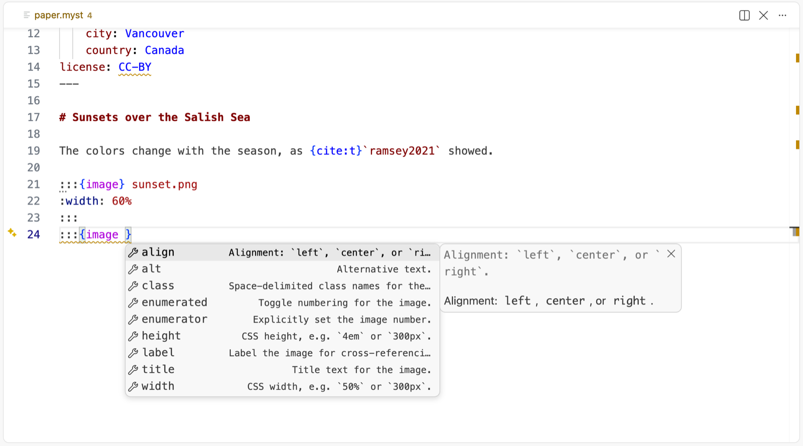
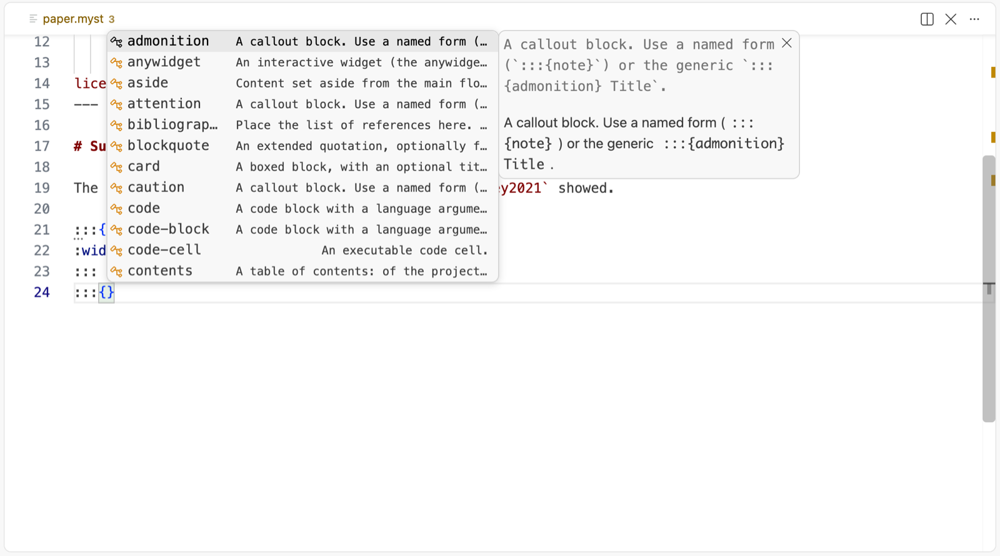
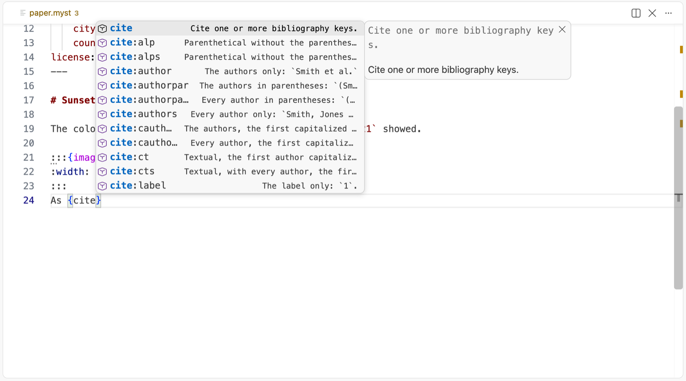
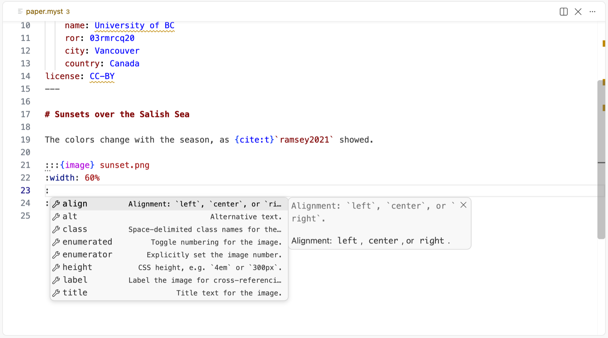
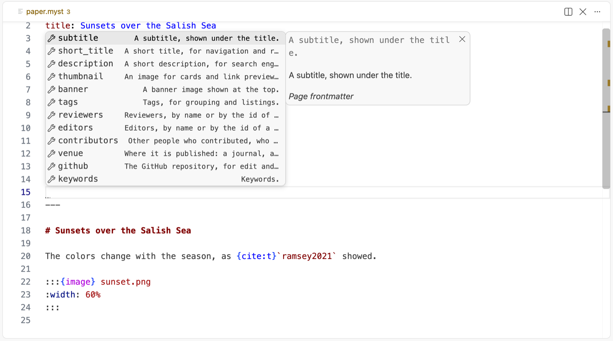
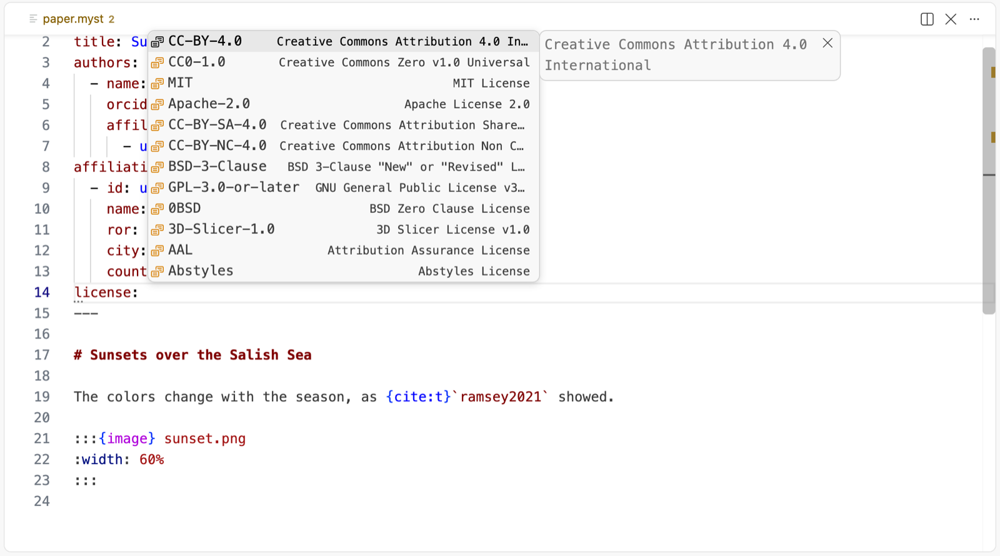
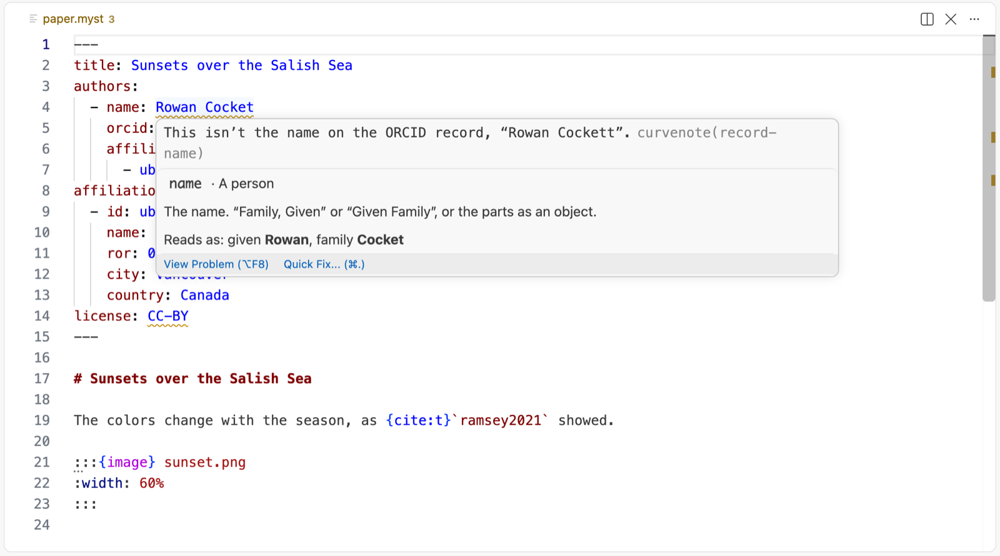
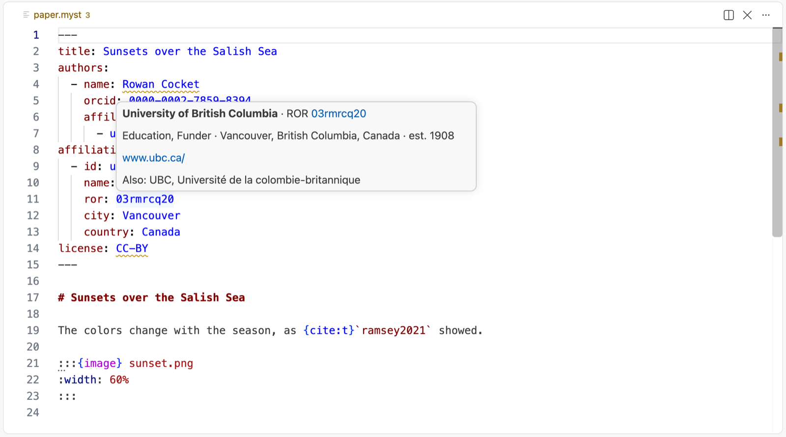
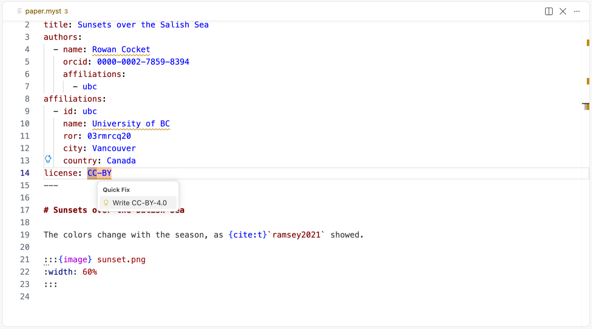

# Curvenote for VS Code

Write [MyST Markdown](https://mystmd.org) with an editor that knows it: suggestions for
directives, roles, options and frontmatter, documentation on hover, checks as you type, ORCID
and ROR records looked up for your authors, and formatting on save. The same language tools run
Curvenote's web editor, so a page reads the same in both.



## Features

### Suggestions as you type

Directives after `:::{` or ` ```{ `: picking one on an empty line writes the whole
directive, with the cursor in its body. Roles after `{`, with the cursor between the
backticks. Each `cite:` variant says what it writes, so `{cite:p}` and `{cite:t}` are easy to
tell apart.





Options inside a `{name …}` header are written as `key=""`, with the cursor between the quotes,
for directives and roles. A directive's `:key:` lines suggest its own options first, and leave
out the ones already written.



### Frontmatter and `myst.yml`

Keys that fit where the cursor is, each with a one-line summary: a page's keys at the top, a
person's keys inside an `authors` item, a license's `content` and `code`. After `key:`, the
values there's a known set of: SPDX licenses with the common ones first, `true` and `false`, a
key's choices, and the ids of the people and affiliations in the same file.





Frontmatter keeps your theme's YAML colors. Hover a key for its documentation, or a value for
what it reads as.

### ORCID and ROR, checked against their records

Each author's ORCID iD and each affiliation's ROR ID is looked up in the public ORCID and ROR
APIs:

- an iD or ID with no record is an **error**;
- a name, city or country that isn't the record's is a **warning**, and a name comes with a
  quick fix that writes the record's;
- hovering an iD shows the record: the person's name and affiliations, or the organization's
  type, location, founding year and website.





A failed lookup (offline, say) shows nothing, never a false error. Turn the lookups off with
`curvenote.frontmatter.checkRecords`.

### Checks and quick fixes

Every message lands on the exact key or value it's about, with a code you can look up:
unknown and duplicate options, invalid values, unknown frontmatter keys (faded, as they're
ignored), YAML syntax errors. Many come with a quick fix: quoting a value with a colon in it,
closing a bracket, writing `CC-BY` as the SPDX id `CC-BY-4.0`, using the name on an ORCID or
ROR record.



### Highlighting, folding and formatting

- **Highlighting** for MyST's constructs (directives, roles, math, targets, comments,
  citations) on top of Markdown, inside lists and blockquotes too.
- **Folding** for directives, code, blockquotes, lists, tables and heading sections.
- **Formatting** on save, to the canonical form, with a hint and a quick fix when a file isn't
  formatted.

## Settings

| Setting                              | Default | What it does                                                                                |
| ------------------------------------ | ------- | ------------------------------------------------------------------------------------------- |
| `curvenote.checkFormatting`          | `true`  | Hint when a file isn't in its canonical formatting.                                         |
| `curvenote.frontmatter.checkRecords` | `true`  | Look up ORCID iDs and ROR IDs, check names and places against them, and show them on hover. |
| `curvenote.frontmatter.forms`        | `{}`    | Whether a picked key is written as a string (`license: `) or opens its fields; see below.   |
| `curvenote.trace.server`             | `off`   | Trace the communication with the language server.                                           |

`curvenote.frontmatter.forms` takes keys by `type.key`, by key, or `*` for every key and `*[]`
for every list: `{ "person.name": "object" }` writes a person's name as `given` and `family`,
`{ "*": "object" }` opens every key's fields. Settings from before the rename (`remyst.*`) are
still read.

## File association

The extension opens `.md` and `.myst` files as MyST, and works in `myst.yml` and
`curvenote.yml` too. MyST is a superset of Markdown, so plain Markdown files work as they are; they
are formatted on save too, which `"[myst]": { "editor.formatOnSave": false }` turns off.

To keep `.md` files as plain Markdown (for VS Code's Markdown preview, or another Markdown
extension), add to your settings, or to a workspace's `.vscode/settings.json` for just that
project:

```jsonc
{
  "files.associations": { "*.md": "markdown" },
}
```

`.myst` files stay MyST either way. To open one `.md` file as the other language, use
**Change Language Mode** in the status bar.

## Issues and releases

Report a bug or ask for a feature in [curvenote/curvenote-vscode](https://github.com/curvenote/curvenote-vscode/issues).
Every release is on the [Marketplace](https://marketplace.visualstudio.com/items?itemName=curvenote.curvenote-vscode),
on [Open VSX](https://open-vsx.org/extension/curvenote/curvenote-vscode), and as a `.vsix` in
the repository's [releases](https://github.com/curvenote/curvenote-vscode/releases), with the
[changelog](https://github.com/curvenote/curvenote-vscode/blob/main/CHANGELOG.md).

---

Made with love by [Curvenote](https://curvenote.com).
